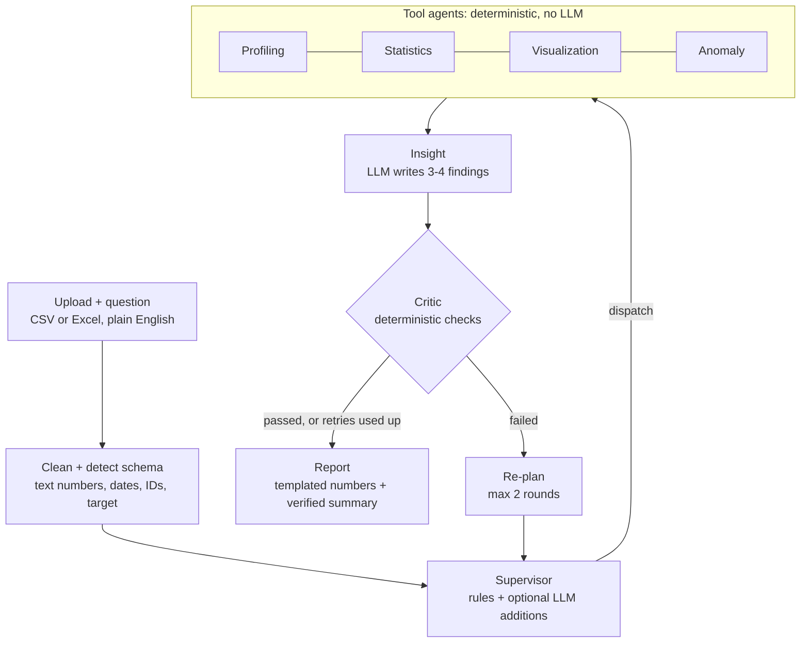
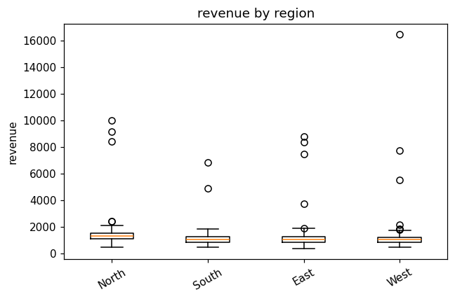
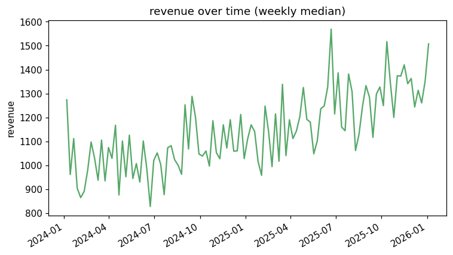
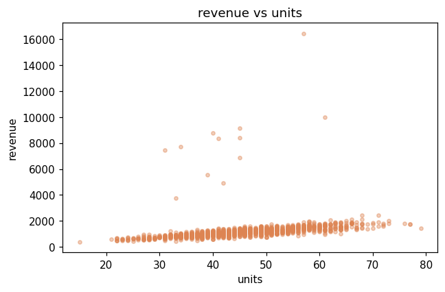
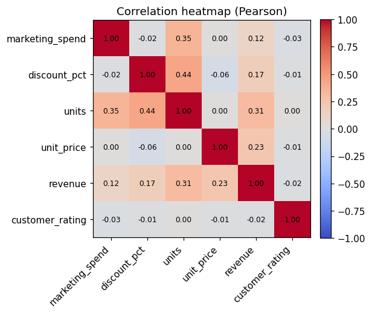
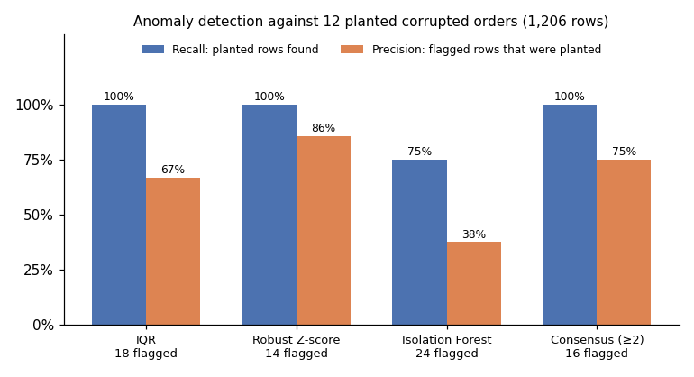
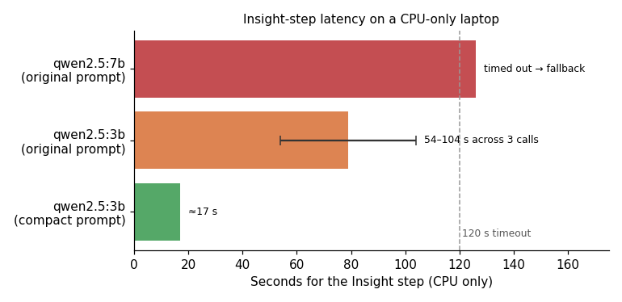

# Agentic EDA: Technical Report

**A local multi-agent system for exploratory data analysis in which the LLM plans and writes, deterministic tools compute, and a verifier checks every claim before it reaches the user.**

Built with LangGraph, Streamlit, Ollama, pandas, SciPy and scikit-learn. Runs fully offline, and still works with no language model at all.

---

## Contents

1. [Problem](#1-problem)
2. [Approach and headline results](#2-approach-and-headline-results)
3. [Architecture](#3-architecture)
4. [Planning](#4-planning)
5. [Analysis methods](#5-analysis-methods)
6. [Verification](#6-verification)
7. [Data handling](#7-data-handling)
8. [Evaluation](#8-evaluation)
9. [Engineering case studies](#9-engineering-case-studies)
10. [Design trade-offs](#10-design-trade-offs)
11. [Limitations](#11-limitations)
12. [Future work](#12-future-work)
13. [Running the project](#13-running-the-project)

---

## 1. Problem

Exploratory data analysis is the first thing anyone does with a new dataset, and the most repetitive: profile the columns, check quality, look for relationships, compare groups, find trends and outliers. LLMs look like a natural fit, because a user could simply ask a question in plain English.

The catch is that **LLMs are unreliable with numbers.** They invent statistics, round inconsistently, and turn correlations into causal claims. In data analysis a confident wrong number is worse than no answer, because people act on it.

This project asks: **how much of EDA can an LLM drive while guaranteeing that every number shown to the user was actually computed?**

## 2. Approach and headline results

The design rests on one rule: **the LLM never computes a number.**

| Responsibility | Done by |
|---|---|
| Deciding which analyses to run | Rule-based Supervisor; the LLM may only add from a whitelist |
| Computing every statistic, chart and anomaly | Deterministic pandas, SciPy and scikit-learn code |
| Writing findings and the summary | LLM, with a deterministic fallback |
| Checking every number and claim the LLM writes | Deterministic Critic |
| Deciding what to redo after a failure | Supervisor, from the Critic's structured feedback |

**Headline results**

| Result | Value |
|---|---|
| Planted anomalies recovered on the evaluation dataset | 12 of 12 (consensus of methods, 75% precision) |
| Planted region effect detected | North highest, Kruskal-Wallis p = 2 × 10⁻²⁹ |
| Planted upward trend detected | +42% along the fitted line, p = 1.7 × 10⁻¹¹ |
| Datasets in the robustness test that ran without crashing | 20 of 20 |
| Automated tests | 36, none requiring a model |
| End-to-end run on a CPU-only laptop with a 3B model | ≈25 seconds |

## 3. Architecture



The system is a LangGraph `StateGraph` with 10 nodes sharing one typed state object (`EDAState`).

| Node | File | Uses the LLM? |
|---|---|---|
| Clean + detect schema | `tools/dataset.py`, `graph/workflow.py` | No |
| Supervisor | `agents/supervisor.py` | Optional: may add whitelisted, feasible tasks |
| Profiling, Statistics, Visualization, Anomaly | `agents/*_agent.py` calling `tools/*.py` | No |
| Insight | `agents/insight_agent.py` | Yes, with a deterministic fallback |
| Critic | `agents/critic_agent.py`, `agents/verification.py` | No |
| Re-plan | `graph/workflow.py` | No |
| Report | `agents/report_agent.py` | Executive summary only, and it is verified |

**Routing.** A dispatcher (`route_next` in `graph/router.py`) runs after the Supervisor and after every tool agent. It sends control to the first agent, in dependency order, that still has pending tasks. Then it goes to the Insight agent if the evidence changed, and otherwise to the Critic. Agents with nothing planned are never visited, and a retry re-runs only the agents whose tasks changed. Visualization runs after Statistics because it plots the strongest correlation and the group comparison the statistics agent chose.

**State discipline.** Each node returns a partial update, which LangGraph merges into the shared state. No custom reducers are used, so agents copy, update and return lists rather than mutating state in place. The DataFrame itself is bound to each tool node with `functools.partial` instead of being stored in state, because it isn't serializable (it would break checkpointing) and copying it through every update would be wasteful.

**Task bookkeeping.** Every planned task ends each round in exactly one bucket:

- `completed_tasks`: the tool returned a usable result;
- `task_errors`: the tool failed, with a `retryable` flag;
- `skipped_tasks`: the Supervisor decided not to run it, with a reason.

A single registry (`agents/tasks.py`) defines each task's owner agent, its feasibility test for a given schema, and the question intents it answers. The Supervisor, dispatcher and Critic all read it, so they can't disagree.

## 4. Planning

The Supervisor builds a plan in two passes.

1. **Rule-based core (always runs).**
   - Every plan starts with profiling.
   - Correlation needs 2 or more numeric columns.
   - Group comparison needs a grouping column and a numeric one.
   - Trend analysis needs a date column.
   - Regression is added when the question asks about drivers or factors.
   - All three anomaly methods are added when the question asks about outliers; otherwise IQR runs as a cheap sanity check.
2. **Optional LLM pass.** The model sees the schema, the question and the current plan, and can suggest additional tasks in JSON mode. Suggestions are filtered against the task whitelist and the feasibility test. Infeasible suggestions are recorded as skipped, with the reason.

Question intents are detected by pattern matching:

| Intent | Example words |
|---|---|
| Anomaly | anomaly, outlier, unusual, suspicious |
| Trend | trend, over time, growth, seasonal |
| Drivers | drive, factor, predict, influence, explain |
| Relationship | correlate, relate, associate |
| Segments | by, compare, across, which region |

The same intent table drives both planning and the Critic's coverage check.

**Re-planning** acts on the Critic's structured feedback. It adds tasks the evidence was missing, re-queues tasks that failed for transient reasons, and marks insights stale (passing along the Critic's exact complaints) so that only the Insight agent re-runs. Successful work is never recomputed.

## 5. Analysis methods

Each method was chosen to stay honest on the skewed, outlier-heavy data typical of business datasets.

| Analysis | Method | Rationale |
|---|---|---|
| Correlation | Pearson and Spearman per pair; pairwise deletion; Benjamini-Hochberg FDR correction | Spearman resists outliers. Pairwise deletion keeps more data than dropping every row with a gap. With 15 columns there are 105 pairs, so about 5 would look significant by chance without correction. |
| Correlation strength | Judged on Spearman when it differs from Pearson by more than 0.2, and the pair is flagged | On the evaluation data, outliers dragged Pearson for units ↔ revenue down to 0.31 while Spearman was 0.80 |
| Group comparison | Kruskal-Wallis across every usable categorical or small-integer column; reports the grouping whose groups differ most | Rank-based, so no normality assumption; testing every grouping avoids arbitrarily picking the first column |
| Class-label targets | If the target is a class code (species, 0/1 churn), each feature is compared across the classes | Regression on multi-class codes would treat categories as quantities, so it is skipped with that reason |
| Trend | Linear fit on period medians, with frequency adapted to the date span (monthly, weekly, daily); slope p-value; change along the fitted line | Medians stop a few extreme rows faking a trend; the fitted change agrees with the slope, unlike noisy first and last points |
| Regression | Standardized features; 25% holdout R² when n ≥ 50; needs about 5 complete rows per feature | Standardized coefficients are comparable in magnitude; holdout R² avoids in-sample optimism |
| Univariate outliers | IQR (k = 1.5) and modified Z-score (median and MAD, threshold 3.5) | A mean/standard-deviation Z-score suffers from *masking*: outliers inflate the standard deviation meant to detect them |
| Multivariate outliers | Isolation Forest on standardized features (contamination 2%, `random_state = 42`) | Finds unusual combinations of values; scaling stops large-unit columns dominating. It flags a fixed share by design, so its output is treated as a ranking |
| Consensus | Rows flagged by at least 2 methods | Agreement between independent methods is the best signal for manual review |

All results are reported as associations. The report says so explicitly, and the Critic enforces it on the LLM's text.

## 6. Verification

The Critic (`agents/critic_agent.py`) is deterministic by design: a safety net shouldn't depend on the component it checks. Each issue it raises is **blocking** (fails the run and triggers a targeted re-plan) or a **warning** (cannot be fixed by retrying, so it goes into the report's Limitations section).

| Check | What it catches | Severity | Re-plan action |
|---|---|---|---|
| Task completion | A planned task that never ran or crashed | Blocking only if the error is transient (memory, I/O, timeout) | Re-queue the task |
| Question coverage | The question asks about anomalies, trends, drivers or segments, but no such evidence exists | Blocking if a feasible task could supply it | Add the missing tasks |
| Evidence and sample size | No tool output at all; fewer than 30 rows | No evidence: blocking. Small sample: warning | Add profiling, or note low power |
| Numeric grounding | A number in a finding that no tool computed | Blocking | Regenerate insights, with feedback |
| Causal language | "causes", "due to", "drives", "leads to" (negations allowed) | Blocking | Regenerate insights, with feedback |

### Numeric grounding

`agents/verification.py` implements the grounding check in four steps:

1. **Collect evidence.** Gather every number in the tool outputs, including numbers that tools state in prose (for example "modified Z-score above 3.5"). Row indices are excluded; otherwise any integer smaller than the row count would pass as evidence.
2. **Extract claims.** Pull every number out of the LLM's text, handling thousands separators, decimals, percentages and scientific notation.
3. **Match with tolerance.** Each claimed number must match some evidence value within its written precision (0.81 matches 0.8123) or 0.5%. A fraction may also appear as a percentage (0.42 ↔ 42%).
4. **Skip non-claims.** Thresholds after `<` or `>` ("p < 0.05"), small integers 0–10 ("top 3") and years 1900–2100 are ignored.

### The loop and failing closed

When the Critic fails, the router sends control to `replan`, which increments `retry_count`, and then back to the Supervisor. This repeats until `MAX_RETRIES = 2` is reached. On each retry the Insight agent's prompt includes the Critic's exact complaints, so regeneration is targeted rather than a blind re-prompt.

If the findings still fail after the last retry, the report **fails closed**. It replaces the LLM's findings with deterministic, template-based findings that are grounded by construction, and it says so in its Verification section. The LLM's executive summary passes through the same grounding and causal-language checks.

### Graceful degradation

Every LLM call goes through `safe_json_call` or `safe_text_call`, each of which requires a deterministic fallback. A cached health check skips calls entirely when Ollama is unreachable. The result is a complete report in every case: the LLM improves the prose but is never required.

## 7. Data handling

Real files are messy, so input passes through a preparation step with a visible audit trail. Every change is listed under Data quality in the report.

**Loading** (`load_table`):

- CSV, TSV, TXT and `.xlsx` (first sheet);
- the delimiter is sniffed, so semicolon-separated files work;
- encodings fall back from UTF-8 to cp1252 to Latin-1.

**Preparation** (`prepare_dataframe`):

| Problem | Handling |
|---|---|
| Numbers stored as text: `$1,234.50`, `€12`, `45%`, `(300)` | Converted to numeric; parentheses become negative |
| European decimal commas: `1.234,50`, `12,5` | Detected per column and converted |
| Infinite values | Treated as missing |
| Day-first dates: `05/01/2023` | One format is chosen per column from about 20 candidates (see case study 4) |
| Column names with stray spaces | Trimmed |

**Schema detection** classifies each column as:

- numeric;
- categorical (at most max(50, 5% of rows) distinct values);
- datetime;
- boolean;
- free text;
- identifier (named like `*_id`, or unique and monotonic integers), which is excluded from analysis.

Integer columns with 2–10 distinct values (such as passenger class or a 1–5 rating) can also serve as grouping columns.

**Target selection.** The target is a numeric column named in the question, matched by whole word or word stem, so "survival" finds `Survived` but a column named `a` does not match "are". Without one, the system falls back to common names such as revenue, sales or price.

## 8. Evaluation

### 8.1 Planted ground truth

Rather than judging output by eye, evaluation uses a synthetic dataset with known structure (`scripts/make_sample_data.py`, fixed seed):

- 1,200 orders over two years, plus 6 exact duplicate rows;
- revenue = units × unit price;
- units rise with marketing spend and discount;
- revenue grows over time;
- the North region sells more than the others;
- 12 orders have revenue inflated 6–10 times, with their indices saved to `data/sample_sales_truth.json`;
- about 4% of ratings are missing, and `order_id` is an identifier.

What the system found, with no LLM involved:

| Planted structure | Detected | Evidence |
|---|---|---|
| Identifier column | `order_id` excluded | Schema detection |
| Duplicates and missing ratings | 6 duplicates (0.5%), 4.06% missing ratings | Profiling |
| Skewed target | Revenue skew 10.19, with a recommendation to prefer rank-based tests | Profiling |
| Units ↔ revenue relationship | Spearman 0.80, labelled strong; Pearson 0.31 flagged as outlier-distorted | Correlation, BH-adjusted p = 2.7 × 10⁻²⁷ |
| North region effect | North mean 1,375.67 vs 1,101.59–1,183.23 for the others | Kruskal-Wallis H = 136.65, p = 2 × 10⁻²⁹; channel tested too, p = 0.23 |
| Upward trend | Increasing over 24 monthly periods, +42.24% along the fitted line | Slope 17.08 per month, p = 1.7 × 10⁻¹¹ |
| Drivers of revenue | Units and unit price have the largest standardized coefficients | Regression (see the note below) |

| | |
|---|---|
|  |  |
|  |  |

*Charts produced by the pipeline itself. The corrupted orders are clearly visible as the points far above the main band in the scatter plot.*

**A note on the regression.** Holdout R² (0.46) came out higher than training R² (0.14), which is unusual. Investigation showed that 9 of the 10 corrupted rows with complete data fell into the training split, and squared-error fitting is dominated by them. With those rows removed, R² is 0.985 on training and 0.983 on holdout. The model is right about the drivers but its fit statistics are outlier-sensitive, which motivates robust regression as future work.

### 8.2 Anomaly detection



| Method | Rows flagged | Recall | Precision |
|---|---|---|---|
| IQR on revenue | 18 | 100% | 67% |
| Robust Z-score on revenue | 14 | 100% | 86% |
| Isolation Forest (all numeric columns) | 24 | 75% | 38% |
| Consensus (at least 2 methods) | 16 | 100% | 75% |

Univariate methods excel here because the corruption is univariate: inflated revenue. Isolation Forest flags a fixed 2% by design and spreads its attention across all columns, so it catches some genuine but uncorrupted extremes. The consensus view keeps full recall while cutting false alarms, which is why the report leads with it.

Some "false positives" are the duplicates of corrupted rows, and some are genuine extremes, which is arguably correct behavior for an anomaly detector.

### 8.3 Robustness on unfamiliar data

The pipeline was stress-tested on 20 datasets chosen to break it, all with the same generic question ("What are the main patterns, what is associated with the target, and are there any outliers?"). All 20 ran to completion and passed verification with no retries. In 2 cases (very heavy missing data), Isolation Forest was correctly skipped with a warning.

| Dataset | What it tests | Result |
|---|---|---|
| Iris, Wine | Class-label target | Features compared across classes; regression ruled out for class codes |
| Diabetes | Continuous target, 11 numeric columns | Correlations and outliers across all columns |
| Titanic-style | Mixed types, missing values, 0/1 outcome | ID and free-text name excluded; groups compared by the 0/1 outcome |
| Only categorical columns | No numeric data | Profiling-only report |
| A single numeric column | Minimal data | Profiling, outliers, one chart |
| 8 rows | Tiny sample | Runs, with a low-power warning |
| 60% of values missing | Heavy missing data | Runs; Isolation Forest skipped with a warning |
| An all-empty column, constant columns | Degenerate columns | Flagged in data quality |
| Text numbers, currency symbols | `"1,234.50"`, `"$12.50"` | Converted; money column becomes the target |
| Day-first dates | `dd/mm/yyyy` | Parsed consistently |
| Hourly timestamps | Fine-grained time | Daily trend |
| Infinite values | `inf` from division | Treated as missing, no retries |
| 60 columns | Wide data | Runs in under 1 second |
| 400-level categorical | High cardinality | Treated as text, not grouped |
| 200,000 rows | Scale | 7.2 seconds end to end |

### 8.4 Test suite

36 pytest tests run in about 6 seconds with no model required:

- **Tools:** recovery of the planted region effect, trend and anomalies (robust Z-score recall at least 90%); FDR correction; holdout validation; tools return errors instead of raising.
- **Verification:** rounding tolerance, invented numbers flagged, thresholds ignored, row indices excluded, negations allowed, and numbers in tool text treated as evidence.
- **Workflow:** passes first time on the happy path; the dispatcher skips agents with no work; a simulated planner miss is fixed by a targeted re-plan that keeps successful work; precondition failures do not loop.
- **Hallucination handling:** a fake LLM that writes "Revenue rose 37%" and causal claims is caught. The tests check that the Critic's feedback reaches the next prompt, and that a persistently hallucinating model fails closed, with "37%" never appearing in the report.
- **LLM client:** the real `ChatOllama` client is constructed in both text and JSON modes.
- **Messy inputs:** text numbers, decimal commas, day-first dates, infinities, semicolon CSVs, Latin-1 encoding, Excel files, class-label targets.

### 8.5 Performance



On a CPU-only laptop, the 7B model exceeded the 120-second timeout on the Insight step, and the system fell back to deterministic findings as designed.

Four changes brought the Insight step to about 17 seconds and a full run to about 25 seconds:

1. switching to `qwen2.5:3b`;
2. cutting the prompt from about 1,500 to 570 tokens by sending only fields a finding could cite;
3. asking for 3–4 findings and capping output at 600 tokens;
4. keeping the model loaded between calls.

On CPU, generation time dominates, so output length mattered most.

## 9. Engineering case studies

Each of these was found through a live run or a stress test, fixed, and locked in with a regression test.

**1. A re-plan loop that didn't re-plan.** The original Supervisor added the Critic's missing tasks only if they weren't already planned, but every missing task *was* already planned, so a retry re-ran an identical pipeline. The fix was structured feedback (tasks to add, tasks to retry, insights to regenerate) plus dispatcher routing, so a retry re-runs only affected agents.

**2. A verifier that rejected a correct number.** In a live run, the Critic rejected "3.5" in two consecutive rounds and the report failed closed. Tracing the round-by-round log showed that 3.5 is the robust Z-score threshold, which appears only in a tool's explanation text, while evidence collection read numeric fields only. The fix was to treat tool-written text as evidence. The lesson: the Critic told the model the number wasn't in its input when it was, so the model repeated it. A verifier's errors compound inside a feedback loop.

**3. A summary that was never written by the LLM.** The per-step timing chart showed the report step taking 0 seconds, and no model writes a summary that fast. Text-mode calls passed `format=None`, which the pinned langchain-ollama version rejects, so every call failed validation instantly and silently used the template. This bug existed in the original code. The lesson: graceful degradation is only safe if it is observable; per-step timing exposed what error handling hid.

**4. Dates scrambled without an error.** Parsing dates value by value read `05/01/2023` as 1 May but `15/01/2023` as 15 January, silently reordering a time series. The fix chooses one format per column, the one that parses the most values.

**5. A chart that contradicted the statistics.** The trend test used weekly medians, but the trend chart plotted weekly means, so the corrupted orders drew spikes the test had correctly ignored. The chart now uses medians as well.

**6. Wasted retries.** Exceptions from deterministic pandas code were marked retryable, so a column of infinite values caused two pointless retry rounds, each re-running the slow LLM step. Only transient errors are retried now, and infinite values are handled during preparation.

## 10. Design trade-offs

| Decision | Benefit | Cost |
|---|---|---|
| LLM never computes | No hallucinated statistics; reproducible, testable numbers | Questions are limited to a fixed set of verified analyses |
| Deterministic Critic | Reproducible and fast; independent of the model it checks | Cannot judge softer qualities such as relevance |
| Rules first, LLM may only add tasks | The plan works with no model; the LLM can't drop or invent tasks | Less flexible than a fully LLM-driven planner |
| Dispatcher routing | Unplanned agents never run; retries are targeted | Dependency order is fixed in code |
| Fail closed | Unverified claims never reach the report | A weak model's findings may be replaced by templates |
| Local model via Ollama | Private, free, offline | Slow on CPU; small models are less reliable |
| Cleaning with an audit trail | Handles real-world files transparently | Heuristics can misjudge unusual formats |

## 11. Limitations

- **Fixed analysis menu.** No clustering, forecasting, two-way breakdowns or custom calculations. This is the deliberate cost of never letting the LLM write code.
- **One target column** focuses the group comparison, trend and univariate outlier analysis.
- **Grounding is lexical.** It verifies that a number exists in the tool output, not that it is attached to the right entity. "West has mean 1,375.67" would pass, because 1,375.67 is a group mean (North's).
- **The causal check is a phrase list.** It can miss implied causation.
- **Trend analysis is linear.** It doesn't model seasonality, and multiple series in one table (for example, per store) are merged into one.
- **Categorical-only data** receives profiling only; there's no test of association between categorical columns.
- **Ordinary least squares is outlier-sensitive**, as the regression note in section 8.1 shows.
- **CPU inference is slow.** The Insight step takes about 17 seconds with a 3B model.

## 12. Future work

1. **Semantic grounding:** check each number against the entity and statistic it is paired with.
2. **Parallel tool agents** with LangGraph's `Send` API and state reducers.
3. **Robust regression** (Huber or quantile) alongside ordinary least squares.
4. **Seasonal decomposition** (STL) and per-entity time series.
5. **Chi-square tests** for categorical associations.
6. **An LLM judge** as a second, softer verification layer for relevance.
7. **Checkpointing and tracing** (LangSmith) for long runs and observability.

## 13. Running the project

```bash
python -m venv venv && source venv/bin/activate   # Windows Git Bash: source venv/Scripts/activate
pip install -r requirements.txt
ollama pull qwen2.5:3b                            # optional; the app works without it
echo "OLLAMA_MODEL=qwen2.5:3b" > .env
streamlit run app.py
pytest -q
```

Requires Python 3.11 or 3.12. In the app, click **Use sample sales data**, choose a suggested question, and run it. Turn on **Simulate a planner miss** in the sidebar to watch the Critic catch missing evidence and the Supervisor re-plan. The Agent trace tab shows every node, every Critic round and the time per step.

See [README.md](../README.md) for configuration and [CHANGES.md](../CHANGES.md) for the full change history.
